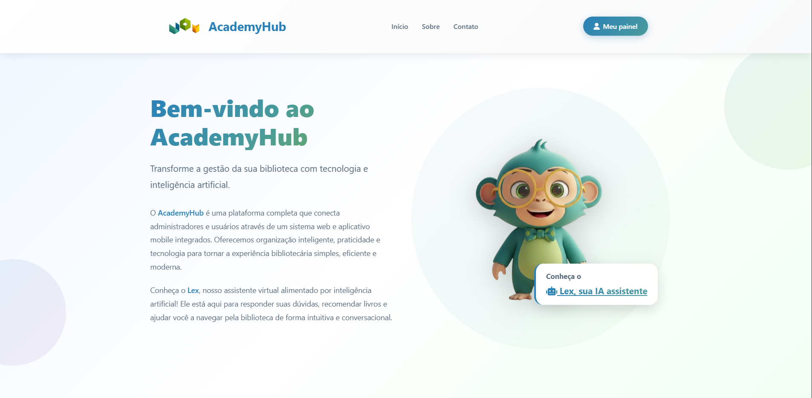
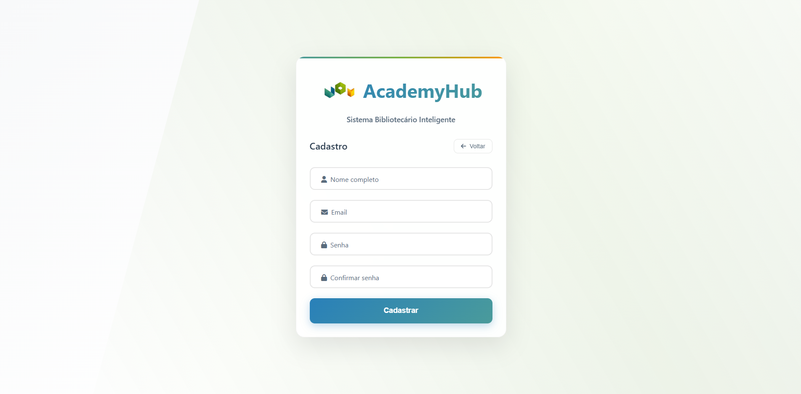
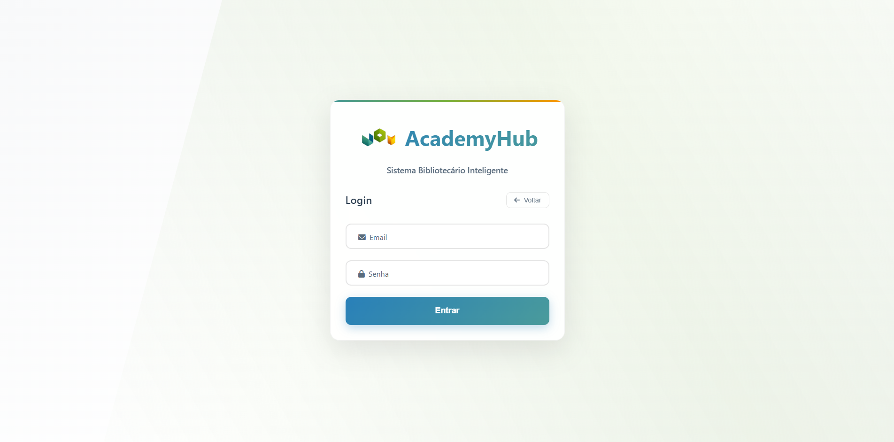
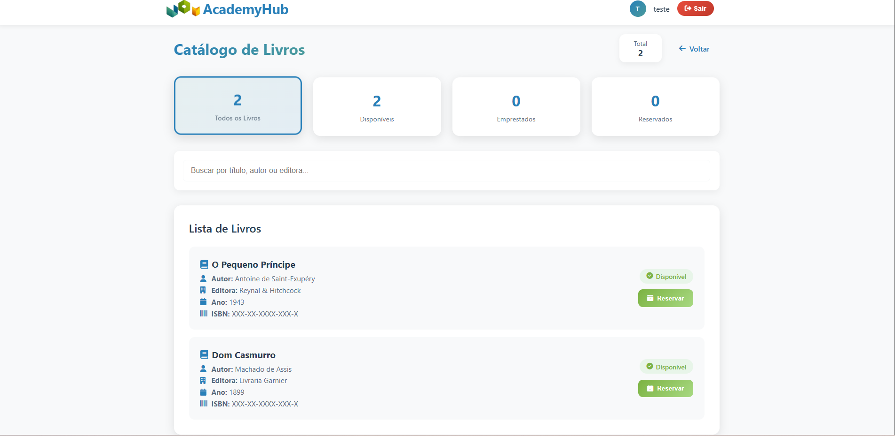
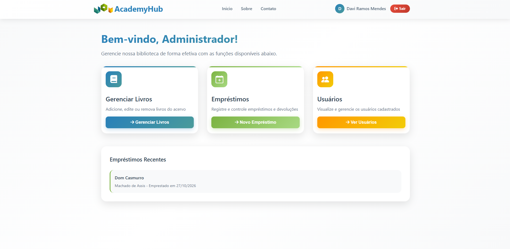
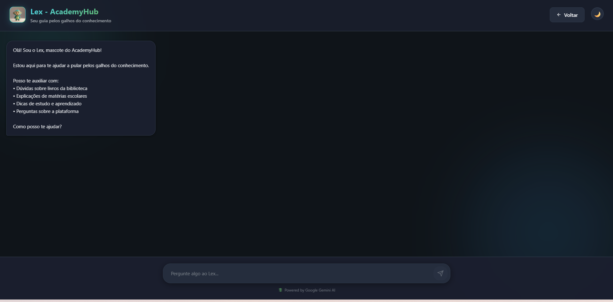

# AcademyHub

Projeto de TCC do curso Técnico em Desenvolvimento de Sistemas da Etec Armando Bayeux da Silva, desenvolvido em 2025. Sistema web de gestão de biblioteca escolar que conecta administradores e alunos em uma plataforma única para catálogo de livros, empréstimos e atendimento por um assistente virtual com IA (Lex).

O TCC também incluiu um aplicativo mobile, que não faz parte deste repositório. Este repositório contém o sistema web e a API do assistente Lex.

## Telas

| Página inicial | Cadastro |
|---|---|
|  |  |

| Login | Catálogo do aluno |
|---|---|
|  |  |

| Painel administrativo | Assistente Lex |
|---|---|
|  |  |

## Funcionalidades

**Área do aluno**
- Catálogo de livros com filtros por status (disponível, emprestado, reservado)
- Reserva de livros
- Acompanhamento e renovação dos próprios empréstimos
- Dashboard com atividades recentes

**Área administrativa**
- Cadastro, edição e exclusão de livros (CRUD), com busca
- Gestão de empréstimos: ativo, em atraso, devolvido, cancelado. Livros reservados pelos alunos aparecem marcados ao registrar um novo empréstimo
- Consulta de usuários e dos empréstimos de cada um
- Dashboard com indicadores do acervo

**Assistente virtual Lex**
- Chatbot integrado ao Google Gemini, com histórico de conversa
- Responde dúvidas sobre livros, matérias, dicas de estudo e sobre a plataforma
- API própria em Node.js + TypeScript, separando a chave da IA do front-end

## Stack

| Camada | Tecnologias |
|---|---|
| Front-end | HTML5, CSS3, JavaScript (vanilla) |
| Autenticação e banco | Firebase Authentication, Cloud Firestore |
| Back-end (chatbot) | Node.js, TypeScript, Express 5 |
| IA | Google Gemini (`gemini-2.5-flash`) via `@google/generative-ai` |

## Arquitetura

```
Navegador (HTML/CSS/JS)
   │
   ├── Firebase Auth ........ login e cadastro
   ├── Cloud Firestore ...... coleções: users, books, rentals
   │
   └── POST /api/chat ──► API Express (TypeScript)
                            ├── validation.middleware  (valida payload)
                            ├── chat.controller
                            ├── gemini.service ──► Google Gemini
                            └── error.middleware
```

A API segue separação em camadas: `routes → middlewares → controllers → services → config`, com tipos compartilhados em `types/`.

## Estrutura do repositório

```
.
├── frontend/          # Aplicação web (páginas públicas, área do aluno e admin)
│   ├── admin/
│   ├── aluno/
│   ├── css/
│   ├── js/
│   └── images/
├── backend/           # API do chatbot (Express + TypeScript + Gemini)
│   ├── src/
│   │   ├── config/
│   │   ├── controllers/
│   │   ├── middlewares/
│   │   ├── routes/
│   │   ├── services/
│   │   ├── types/
│   │   └── server.ts
│   └── .env.example
├── chatbot-demo/      # Página isolada para testar o chatbot sem o restante do sistema
├── firestore.rules            # Regras de segurança do Firestore (por perfil)
└── firestore.indexes.json     # Índices compostos do Firestore
```

## Teste rápido

1. Clone o repositório e abra a pasta `frontend/` com o Live Server.
2. O projeto já aponta para o Firebase do AcademyHub: basta se cadastrar como aluno para testar catálogo, reserva e empréstimos.
3. A área administrativa não tem conta pública de demonstração (veja os prints em [Telas](#telas)).
4. O chatbot Lex exige rodar o back-end com uma chave própria do Gemini (veja [Como executar](#como-executar)).

## Como executar

### Pré-requisitos
- Node.js 18+
- Chave da API do Google Gemini ([Google AI Studio](https://aistudio.google.com/))
- Extensão Live Server (VS Code) ou outro servidor estático

### 1. Back-end (chatbot)

```bash
cd backend
npm install
cp .env.example .env      # preencha GEMINI_API_KEY
npm run dev               # http://localhost:3001
```

Teste rápido: `GET http://localhost:3001/health`

### 2. Front-end

Abra a pasta `frontend/` com o Live Server (porta padrão 5500) e acesse `index.html`.

O `FRONTEND_URL` do `.env` precisa ser igual à origem do navegador. O Live Server pode abrir em `127.0.0.1:5500` ou em `localhost:5500`; se forem diferentes, o chatbot é bloqueado pelo CORS.

### 3. Firebase

O front-end usa um projeto Firebase próprio, configurado em `frontend/js/firebase-config.js`. Para usar outro projeto, substitua esses valores pelos do seu Firebase.

No console do Firebase:

1. Ative **Authentication** (e-mail/senha) e crie o banco **Cloud Firestore**.
2. Publique as regras de `firestore.rules` (aba Regras) e o índice de `firestore.indexes.json` (aba Índices). O índice leva alguns minutos para ficar "Ativo".
3. **Primeiro administrador:** o cadastro só cria contas de aluno. Cadastre-se como aluno, abra a coleção `users` no console do Firestore e troque o campo `role` do seu documento para `admin`. Depois use "Sou Administrador" no login.

## Endpoints da API

| Método | Rota | Descrição |
|---|---|---|
| GET | `/health` | Status da API |
| POST | `/api/chat` | Envia mensagem ao Lex |

Exemplo de requisição:

```json
POST /api/chat
{
  "message": "Me indica um livro de ficção científica?",
  "history": [
    { "role": "user", "content": "Oi" },
    { "role": "assistant", "content": "Olá! Como posso ajudar?" }
  ]
}
```

Resposta:

```json
{ "success": true, "message": "..." }
```

## Limitações conhecidas e próximos passos

- **Controle de acesso:** as permissões por perfil são garantidas pelas Security Rules do Firestore (`firestore.rules`): o cadastro só cria perfil de aluno e o perfil admin é atribuído pelo console. Próximo passo: migrar perfis para Firebase Custom Claims.
- **Prompt do sistema:** hoje é enviado junto de cada mensagem. Próximo passo: usar `systemInstruction` do Gemini.
- **Configuração:** a URL da API está fixa em `localhost`. Próximo passo: variável por ambiente e deploy (ex.: Render/Railway para a API, Firebase Hosting para o front).
- **Testes:** adicionar testes automatizados da API (Jest + Supertest).
- **Regras do Firestore mais restritivas:** hoje qualquer usuário logado lê todos os empréstimos (`rentals`), e um aluno consegue sobrescrever a reserva de outro ou gravar qualquer `dueDate`/`renewCount`. Os limites de reserva e de renovação (3 vezes, +14 dias) só são validados no navegador. Próximo passo: restringir a leitura ao próprio aluno e validar esses campos nas regras (ou mover a lógica para um back-end).
- **Verificação de perfil nas telas de admin:** `admin/livros`, `admin/emprestimos-admin` e `admin/usuarios-admin` não checam o perfil na própria página; os dados continuam protegidos pelas regras, mas um aluno que abrir a URL vê a tela vazia ou com erros.
- **Formulário de contato:** é apenas ilustrativo, não envia mensagens.
- **Chave do Firebase:** a `apiKey` em `firebase-config.js` é pública por natureza; próximo passo é restringi-la por referenciador HTTP no Google Cloud.
- **Licença:** ainda não definida.

## Equipe

Projeto desenvolvido em grupo por Davi Mendes, Jonathas e Lucas.

A revisão pós-curso descrita abaixo foi feita por Davi Mendes.

## Uso de IA no desenvolvimento

O projeto foi desenvolvido como TCC do curso técnico, com apoio do Claude (chat) para tirar dúvidas, revisar código e estruturar funcionalidades.

Após a conclusão do curso, revisei e aprimorei o sistema com o Claude Code, como forma de praticar o desenvolvimento assistido por IA e aplicá-lo de maneira crítica: revisando cada sugestão, entendendo as mudanças e validando o resultado com testes manuais. Principais melhorias:

- Migração para um projeto Firebase próprio
- Regras de segurança do Firestore por perfil (aluno/admin) e índices versionados em `firestore.indexes.json`
- Credenciais fora do versionamento (`.env` no `.gitignore`, com `.env.example` como modelo) e atualização de dependências com `npm audit fix`
- Cadastro restrito a alunos; o perfil admin é definido pelo console do Firebase
- Botão "Meu painel" na página inicial para quem já está logado (`js/auth-nav.js`)
- Correção do link do chatbot no painel do aluno
- Atividades recentes do aluno corrigidas, lendo apenas os empréstimos do próprio usuário
- Fluxo de reserva: o admin vê os livros reservados ao registrar um empréstimo, e a reserva é limpa na devolução, no cancelamento e na exclusão
- Prompt do Lex ajustado para descrever apenas os recursos que existem
- Remoção de telefone pessoal da página de contato e correção de um erro de console no catálogo
- README revisado para refletir fielmente o que o código faz
